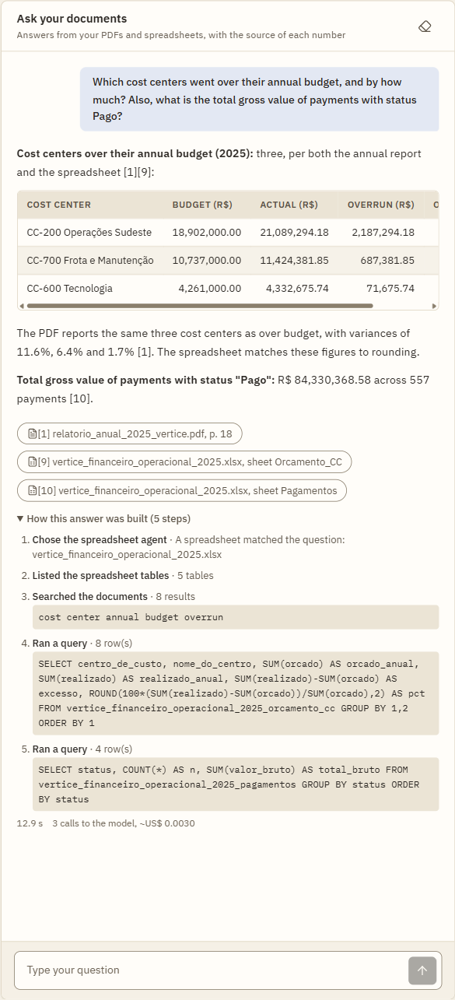
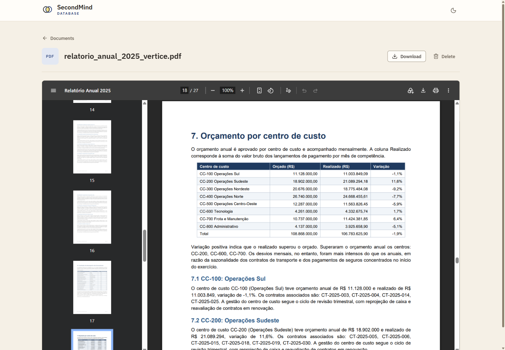
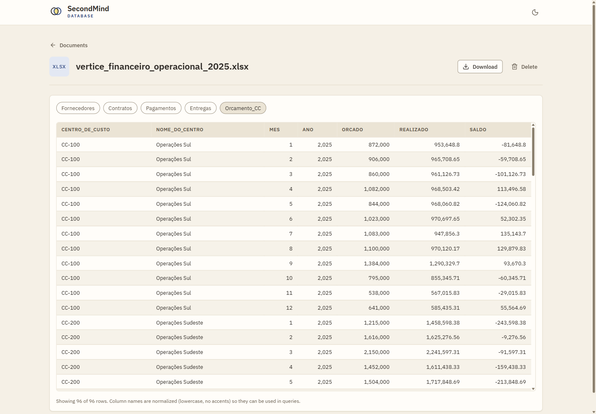
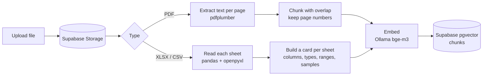
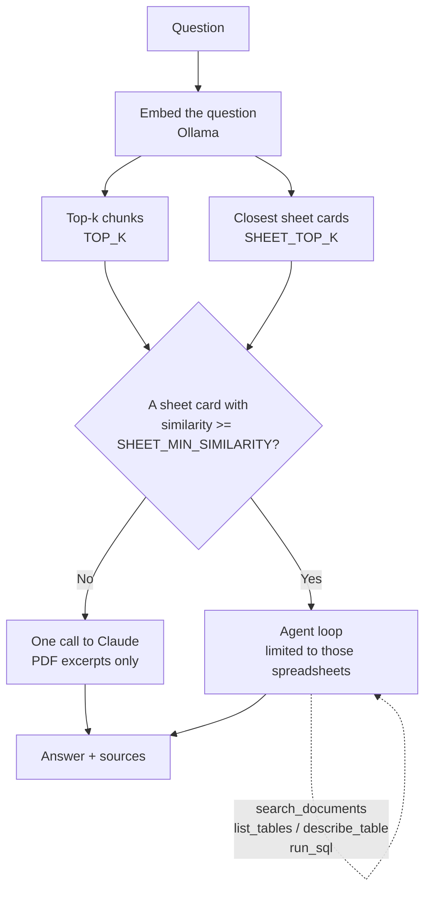
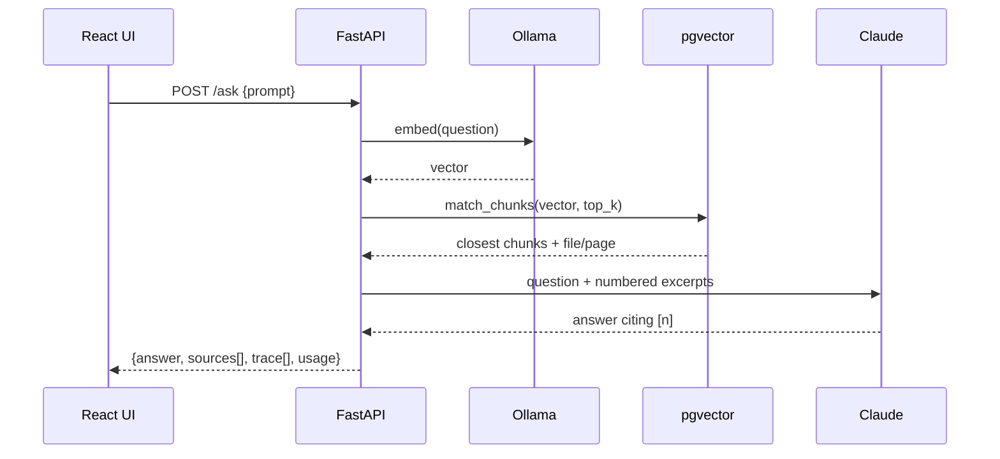

<div align="center">

# SecondMind

**Upload PDFs, Excel and CSV files, then ask questions about your whole library at once.**<br/>
Text answers cite the file and page. Numbers are calculated with real SQL, not guessed.


<sub>A question answered from a PDF **and** an Excel file, with the source of each number. Screenshots use fictional sample data.</sub>

</div>

## Highlights

| | PDFs | Excel and CSV | Both together |
|---|---|---|---|
| **How it is read** | Split into overlapping chunks that keep the page number | Each sheet becomes a SQL table plus a short "card" used to find it | One question can use both |
| **How it answers** | Closest chunks go to Claude (RAG) | A Claude **agent** writes and runs read-only SQL (DuckDB) | The agent also searches the PDFs |
| **What you get** | Answer + `file, p. N` citations | Exact sums, averages and counts + the SQL used | Answer + sources + a step-by-step trace |

- **Single user**: no sign-up, login or email.
- **One knowledge base**: every uploaded file feeds it.
- **Local embeddings** with **Ollama**; answers by **Claude** ([Anthropic API](https://docs.anthropic.com)); **Supabase** stores the file list, the vectors (Postgres + pgvector) and the files (Storage).
- **Cheap by default**: the agent only runs when a spreadsheet is clearly related to the question. Every agent answer shows how many calls it took and the estimated cost.

> **No authentication:** anyone who can reach the API can use it. It binds to `127.0.0.1`; do not expose it to the internet.

## Contents

[A quick tour](#a-quick-tour) · [How it works](#how-it-works) · [Excel and CSV (agent)](#excel-and-csv-agent) · [Try it with sample data](#try-it-with-sample-data) · [Requirements](#requirements) · [Running](#running) · [API](#api) · [Frontend](#frontend) · [Project structure](#project-structure) · [Known limitations](#known-limitations)

## A quick tour

### Themes

The **Paper** and **Night** themes of the "brainstorming notebook" identity. Your choice is remembered.

<p align="center">
  
  
</p>

### Ask a question, see how it was answered

When a question needs a spreadsheet, the chat shows **how the answer was built**: why the agent was called, which tables it looked at, every SQL query it ran, how many model calls it took and the estimated cost. Numbers are never a black box.

<p align="center">
  
</p>

### Click a source to open it

Every citation is a link. A PDF source opens the file **at the cited page**; a spreadsheet source opens a preview of the sheet that was used.

<p align="center">
  
  
</p>
<p align="center"><sub>Left: <code>relatorio_anual_2025_vertice.pdf</code> at page 18. Right: the <code>Orcamento_CC</code> sheet, one tab per sheet.</sub></p>

## How it works

**Ingestion** (on upload, in the background). A PDF becomes text chunks; a spreadsheet becomes cards (and its original file stays in Storage):



**Asking a question.** One embedding feeds the search, then the app decides between a plain RAG answer and the agent:



The plain RAG path, step by step:



Ingestion runs in the background (`BackgroundTasks`); a file is `pending`, `processing`, `ready` or `failed`. There is no OCR: a PDF without text becomes `failed`.

## Excel and CSV (agent)

Besides PDFs you can upload `.xlsx` and `.csv` files, and ask questions that cross both.

### Why an agent

A spreadsheet is numbers, not text. Cutting it into chunks makes a model guess sums and averages. Instead, Claude gets **tools** and calculates for real.

### What the agent can do

`POST /ask` runs the agent loop ([app/services/agent_service.py](app/services/agent_service.py)). Claude calls these tools until it can answer:

| Tool | What it does |
|---|---|
| `search_documents` | The same vector search as before (PDF excerpts and sheet cards) |
| `list_tables` | Lists the spreadsheet tables (one per sheet) |
| `describe_table` | Shows the columns and types of a table |
| `run_sql` | Runs one read-only `SELECT` over the tables, executed by **DuckDB** in memory |

Tables are named after the file and the sheet, e.g. `vendas_2025.xlsx` + `Janeiro` → `vendas_2025_janeiro` (a CSV uses just the file name).

### How a spreadsheet is ingested

- Each sheet becomes a short **card** (columns, types, ranges, sample rows) that is embedded like a PDF chunk, so the search can find the right spreadsheet. The rows themselves are not embedded.
- Column names are normalized (lowercase, no accents, `_`) so they can be used in SQL: `Valor Bruto` → `valor_bruto`.
- Brazilian formats are understood: text such as `R$ 1.234,56` and `31/12/2025` is converted to numbers and dates, and CSVs with `;` and decimal commas are read correctly.

### When the agent runs (routing)

The agent costs more than a plain RAG answer, so a spreadsheet is only used when it is clearly related to the question. On each question (`retrieval_service.retrieve_routed`), one embedding feeds two searches: the normal top-k chunks and the `SHEET_TOP_K` closest sheet cards on their own (so a card is not crowded out by the many PDF chunks). A spreadsheet is relevant only if one of its cards has cosine similarity of at least `SHEET_MIN_SIMILARITY` with the question, in either search.

- **Relevant spreadsheet found:** agent, limited to those spreadsheets.
- **None reaches the threshold:** spreadsheets are discarded and the question is answered from the PDFs only (search + one call to Claude). There is no fallback to the agent, even if the answer is "not found".
- The first step of the answer's `trace` says why the agent was called.

### Safety

The SQL sandbox ([app/services/query_engine.py](app/services/query_engine.py)):

- accepts a **single `SELECT`** (no DDL/DML, no multiple statements);
- has **no file or network access**;
- caps the rows returned (`SQL_MAX_ROWS`) and stops slow queries (`SQL_TIMEOUT_SECONDS`).

Nothing is persisted and there is no cache: the sheets are loaded from Storage for each question that needs them. Cell text is treated as data, not instructions.

### Cost and transparency

A PDF-only question is one call to Claude. With a relevant spreadsheet, each question takes several calls (one per tool step, up to `MAX_AGENT_STEPS`). The answer returns `trace` (the steps and SQL used) and `usage` (calls, tokens, estimated cost), and the chat shows them (see the [tour](#ask-a-question-see-how-it-was-answered)).

### Limits

- The header must be in the first row of each sheet.
- Formulas are read as their last saved value.
- Old `.xls` is not supported.

## Try it with sample data

The folder [docs/test-data/](docs/test-data/) has a fictional company (**Vértice Logística S.A.**) with four linked files: two PDFs (annual report, supplier contracts), an Excel file with 5 sheets and a CSV of incidents. [GABARITO.md](docs/test-data/GABARITO.md) lists questions with the expected answers (in Portuguese). Upload the four files and try:

| Question | Where the answer lives | Expected |
|---|---|---|
| What is the total gross value of payments with status *Pago*? | Excel (SQL) | R$ 84.330.368,58 |
| Which cost centers went over their annual budget? | Excel (SQL) + PDF page 18 | CC-200, CC-700, CC-600 |
| Which region had the best and the worst SLA? | Excel (SQL) | Norte (95,53%) / Sul (92,55%) |
| What does the report say about the SLA, and does it match the deliveries data? | PDF + Excel | The report says 96,0%; the data says 93,74% |

The files also contain **deliberate inconsistencies** between the PDF and the spreadsheet (the SLA above, the value and status of some contracts), to check that an answer points them out instead of trusting only one source.

## Requirements

- [uv](https://docs.astral.sh/uv/) (it installs Python 3.13) and Node.js 20.19+ (or 22.12+)
- A [Supabase](https://supabase.com) project
- [Ollama](https://ollama.com) installed, with the embedding model: `ollama pull bge-m3`
- An [Anthropic API](https://console.anthropic.com/settings/keys) key with credit

## Running

1. In Supabase, open the *SQL Editor*, paste the contents of `schema.sql` and run it. It creates `documents`, `chunks` (pgvector), the `match_chunks` function (with RLS on and no policies, since only the backend accesses them) and the private `pdfs` bucket (which also accepts `.xlsx` and `.csv`). The script is idempotent: running it again on an existing database applies the Excel/CSV changes. PDFs uploaded before RAG existed have no chunks: delete and re-upload them.
2. `cp .env.example .env` and fill in `SUPABASE_URL`, `SUPABASE_SERVICE_ROLE_KEY` (*Project Settings > API*; backend only) and `ANTHROPIC_API_KEY`.
3. Backend: `uv sync && uv run python main.py` (docs at http://localhost:8000/docs).
4. Frontend: `cd frontend && npm install && npm run dev` (http://localhost:5173). If the API is at another address, copy `frontend/.env.example` to `frontend/.env` and adjust `VITE_API_URL`.

The frontend port is fixed (`strictPort`) because the backend only allows that origin in CORS (`FRONTEND_URL`). If you change one, change the other.

### Environment variables (`.env`)

**General and RAG**

| Variable | Default | What it does |
|---|---|---|
| `SUPABASE_URL` | — | Supabase project URL |
| `SUPABASE_SERVICE_ROLE_KEY` | — | Service role key (never in the frontend) |
| `SUPABASE_STORAGE_BUCKET` | `pdfs` | File bucket (PDF, Excel and CSV) |
| `FRONTEND_URL` | `http://localhost:5173` | Origin allowed by CORS |
| `ANTHROPIC_API_KEY` | — | Claude API key |
| `ANTHROPIC_MODEL` | `claude-haiku-5-5` | Model used for answers |
| `ANTHROPIC_EFFORT` | `low` | `low`, `medium` or `high` (lower = faster and cheaper) |
| `MAX_OUTPUT_TOKENS` | `2048` | Answer token limit |
| `LLM_TIMEOUT_SECONDS` | `120` | Maximum time waiting for the model |
| `OLLAMA_BASE_URL` | `http://localhost:11434` | Ollama address |
| `EMBEDDING_MODEL` | `bge-m3` | Embedding model (multilingual) |
| `EMBEDDING_DIM` | `1024` | Vector size; must match `vector(N)` in `schema.sql` |
| `CHUNK_SIZE` / `CHUNK_OVERLAP` | `600` / `80` | Chunk size and overlap (approximate tokens) |
| `TOP_K` | `8` | Chunks sent to Claude per question |
| `MAX_UPLOAD_MB` | `20` | Maximum file size |
| `DOWNLOAD_URL_EXPIRES_SECONDS` | `300` | Lifetime of the download/view link |

**Excel / CSV agent**

| Variable | Default | What it does |
|---|---|---|
| `MAX_AGENT_STEPS` | `6` | Maximum calls to the model per question when spreadsheets are involved |
| `SHEET_TOP_K` | `3` | How many sheet cards are searched on their own to decide if the agent is needed |
| `SHEET_MIN_SIMILARITY` | `0.45` | Minimum cosine similarity for a card to count as relevant; raise it to use the agent less, lower it to use it more |
| `SQL_MAX_ROWS` | `50` | Rows returned to the model by one SQL query |
| `SQL_TIMEOUT_SECONDS` | `15` | A SQL query running longer is stopped |
| `PRICE_INPUT_PER_MTOK` / `PRICE_OUTPUT_PER_MTOK` | `0.10` / `0.50` | USD per million tokens, only to show the estimated cost (defaults are Haiku 5.5) |

The 20 MB limit is also set on the bucket in `schema.sql`; if you raise `MAX_UPLOAD_MB`, adjust the bucket too.

## API

| Endpoint | What it does |
|---|---|
| `POST /documents/upload` | Uploads a PDF, `.xlsx` or `.csv` (multipart, field `file`, up to `MAX_UPLOAD_MB`); ingestion continues in the background |
| `GET /documents/` | Lists files with `file_type`, `status`, `error`, `page_count` (PDF) and `sheet_count` / `row_count` (spreadsheets) |
| `GET /documents/{id}/preview` | First rows of each sheet of a spreadsheet (`{filename, sheets[]}`) |
| `GET /documents/{id}/download` | `{url, filename}`: a temporary link that downloads the file; with `?inline=true`, to view it |
| `POST /ask` | `{prompt}` → `{answer, sources[], trace[], usage}`. Each source has `kind` (`pdf` or `sheet`), `document_id`, `filename` and either `page_start` / `page_end` or `sheet_name` + `sql`. `trace` and `usage` are filled only on the agent path |
| `DELETE /documents/{id}` | Deletes the record (and chunks, by cascade) and the file (204) |

Upload errors: unsupported or invalid file → 400, over the limit → 413, file already uploaded (same hash) → 409. Unknown document → 404.
Model errors: timeout → 504, rate limit → 429, invalid key/credit → 502, Ollama down → 503.

## Frontend

React + Vite, Axios, Tailwind v4, React Router and TanStack Query, with the **SecondMind** identity (the "brainstorming notebook": paper, ink, blue pen and highlighter; *Paper* and *Night* themes).

- `/`: your files (multi-file upload of PDF, Excel and CSV, processing status, search by name, download and delete) next to a chat over the whole base, with clickable sources and the "how this answer was built" trace.
- `/documents/:id?page=N`: a PDF opened at the cited page, or a spreadsheet preview with one tab per sheet.

Chat history and theme are kept in the browser (`localStorage`); the backend stores none of it.

## Project structure

```
main.py                    # starts uvicorn (127.0.0.1:8000, with reload)
schema.sql                 # documents, chunks (pgvector), match_chunks and the storage bucket (idempotent)
app/
  main.py                  # FastAPI + CORS
  routes/                  # declare the endpoints and delegate to the controller
  controllers/             # business rules and error-to-HTTP translation
  models/                  # input/output shapes (pydantic)
  services/
    document_service.py    # documents table (Supabase)
    storage_service.py     # files in Storage (upload, download, signed link, remove)
    pdf_service.py         # extracts text per page (pdfplumber)
    spreadsheet_service.py # reads xlsx/csv, normalizes columns, coerces BR formats, builds sheet cards
    chunking_service.py    # splits into overlapping chunks, keeping the pages
    embedding_service.py   # embeddings via Ollama (/api/embed)
    ingestion_service.py   # extract -> chunk/card -> embed -> store (background)
    retrieval_service.py   # embeds the question, fetches top-k chunks and routes to the agent
    llm_service.py         # asks Claude (plain RAG path) and returns the sources
    agent_service.py       # the agent loop: Claude + tools, trace and usage
    agent_tools.py         # search_documents, list_tables, describe_table, run_sql
    query_engine.py        # DuckDB sandbox: single read-only SELECT, row cap, timeout
  core/config.py           # environment variables
  db/client.py             # Supabase client (service role)
  db/vector_store.py       # chunk inserts and the match_chunks RPC
frontend/                  # React + Vite with the SecondMind identity
docs/screenshots/          # images used in this README
docs/test-data/            # fictional sample files and expected answers
```

Flow: `Route -> Controller -> Service`.

## Known limitations

- Single user, no authentication: meant to run locally.
- No OCR: scanned PDFs cannot be ingested.
- Spreadsheet questions take several calls to the model, so they are slower and cost more than PDF-only questions.
- Ingestion runs inside the API process; a restart marks in-flight documents as `failed`.
- Changing the embedding model or dimension requires editing `schema.sql` and re-uploading the files.
