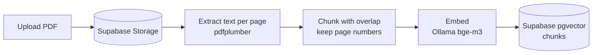
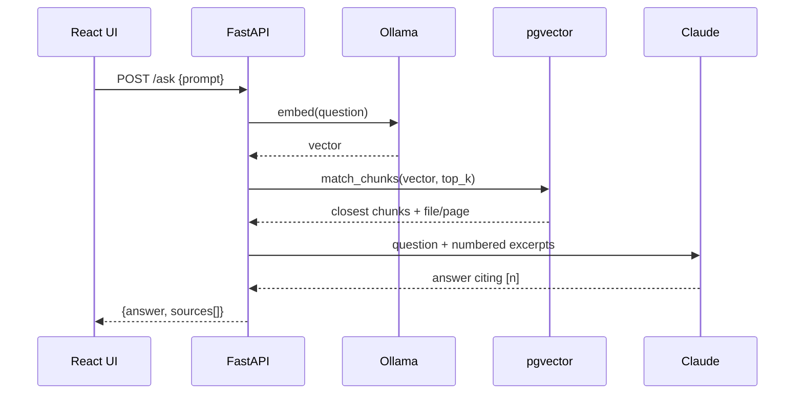

# SecondMind

**Upload PDFs and ask questions about your whole library at once.** Answers come from your own documents and cite the file and page they came from.


<p align="center">
  
  
</p>
<p align="center"><sub>The Paper and Night themes. Screenshots use sample data.</sub></p>

A personal, open source project:

- **Single user**: no sign-up, login or email.
- **One knowledge base**: every uploaded PDF feeds it.
- **RAG**: on upload, each PDF is split into chunks (keeping the source page) and embedded locally with **Ollama**. When you ask a question, the closest chunks (vector search) are sent to **Claude** ([Anthropic API](https://docs.anthropic.com)), which answers citing file and page.
- **Supabase** stores the PDF list and the vectors (Postgres + pgvector) and the files (Storage).
- Ingestion runs in the background (`BackgroundTasks`); a PDF is `pending`, `processing`, `ready` or `failed`. There is no OCR: a PDF without text becomes `failed`.

> **No authentication:** anyone who can reach the API can use it. It binds to `127.0.0.1`; do not expose it to the internet.

## How it works

**Ingestion** (on upload, in the background):



**Asking a question**:



## Requirements

- [uv](https://docs.astral.sh/uv/) (it installs Python 3.13) and Node.js 20.19+ (or 22.12+)
- A [Supabase](https://supabase.com) project
- [Ollama](https://ollama.com) installed, with the embedding model: `ollama pull bge-m3`
- An [Anthropic API](https://console.anthropic.com/settings/keys) key with credit

## Project structure

```
main.py                    # starts uvicorn (127.0.0.1:8000, with reload)
schema.sql                 # documents, chunks (pgvector), match_chunks and the pdfs bucket (idempotent)
app/
  main.py                  # FastAPI + CORS
  routes/                  # declare the endpoints and delegate to the controller
  controllers/             # business rules and error-to-HTTP translation
  models/                  # input/output shapes (pydantic)
  services/
    document_service.py    # documents table (Supabase)
    storage_service.py     # PDFs in Storage (upload, download, signed link, remove)
    pdf_service.py         # extracts text per page (pdfplumber)
    chunking_service.py    # splits into overlapping chunks, keeping the pages
    embedding_service.py   # embeddings via Ollama (/api/embed)
    ingestion_service.py   # extract -> chunk -> embed -> store (background)
    retrieval_service.py   # embeds the question and fetches the top-k chunks
    llm_service.py         # asks Claude with the chunks and returns the sources
  core/config.py           # environment variables
  db/client.py             # Supabase client (service role)
  db/vector_store.py       # chunk inserts and the match_chunks RPC
frontend/                  # React + Vite with the SecondMind identity
docs/screenshots/          # images used in this README
```

Flow: `Route -> Controller -> Service`.

## Running

1. In Supabase, open the *SQL Editor*, paste the contents of `schema.sql` and run it. It creates `documents`, `chunks` (pgvector), the `match_chunks` function (with RLS on and no policies, since only the backend accesses them) and the private `pdfs` bucket. PDFs uploaded before RAG existed have no chunks: delete and re-upload them.
2. `cp .env.example .env` and fill in `SUPABASE_URL`, `SUPABASE_SERVICE_ROLE_KEY` (*Project Settings > API*; backend only) and `ANTHROPIC_API_KEY`.
3. Backend: `uv sync && uv run python main.py` (docs at http://localhost:8000/docs).
4. Frontend: `cd frontend && npm install && npm run dev` (http://localhost:5173). If the API is at another address, copy `frontend/.env.example` to `frontend/.env` and adjust `VITE_API_URL`.

The frontend port is fixed (`strictPort`) because the backend only allows that origin in CORS (`FRONTEND_URL`). If you change one, change the other.

### Environment variables (`.env`)

| Variable | Default | What it does |
|---|---|---|
| `SUPABASE_URL` | — | Supabase project URL |
| `SUPABASE_SERVICE_ROLE_KEY` | — | Service role key (never in the frontend) |
| `SUPABASE_STORAGE_BUCKET` | `pdfs` | PDF bucket |
| `FRONTEND_URL` | `http://localhost:5173` | Origin allowed by CORS |
| `ANTHROPIC_API_KEY` | — | Claude API key |
| `ANTHROPIC_MODEL` | `claude-haiku-5-5` | Model used for answers |
| `ANTHROPIC_EFFORT` | `low` | `low`, `medium` or `high` (lower = faster and cheaper) |
| `MAX_OUTPUT_TOKENS` | `2048` | Answer token limit |
| `LLM_TIMEOUT_SECONDS` | `120` | Maximum time waiting for the model |
| `OLLAMA_BASE_URL` | `http://localhost:11434` | Ollama address |
| `EMBEDDING_MODEL` | `bge-m3` | Embedding model (multilingual) |
| `EMBEDDING_DIM` | `1024` | Vector size; must match `vector(N)` in `schema.sql` |
| `CHUNK_SIZE` / `CHUNK_OVERLAP` | `600` / `80` | Chunk size and overlap (approximate tokens) |
| `TOP_K` | `8` | Chunks sent to Claude per question |
| `MAX_UPLOAD_MB` | `20` | Maximum PDF size |
| `DOWNLOAD_URL_EXPIRES_SECONDS` | `300` | Lifetime of the download/view link |

The 20 MB limit is also set on the bucket in `schema.sql`; if you raise `MAX_UPLOAD_MB`, adjust the bucket too.

## API

| Endpoint | What it does |
|---|---|
| `POST /documents/upload` | Uploads a PDF (multipart, field `file`, up to `MAX_UPLOAD_MB`); ingestion continues in the background |
| `GET /documents/` | Lists PDFs with `status`, `error` and `page_count` |
| `GET /documents/{id}/download` | `{url, filename}`: a temporary link that downloads the PDF; with `?inline=true`, to view it |
| `POST /ask` | `{prompt}` → `{answer, sources[]}`. Answers only from the retrieved chunks; each source has `document_id`, `filename`, `page_start`, `page_end` |
| `DELETE /documents/{id}` | Deletes the record (and chunks, by cascade) and the file (204) |

Upload errors: not a PDF → 400, over the limit → 413, PDF already uploaded (same hash) → 409. Unknown document → 404.
Model errors: timeout → 504, rate limit → 429, invalid key/credit → 502, Ollama down → 503.

## Frontend

React + Vite, Axios, Tailwind v4, React Router and TanStack Query, with the **SecondMind** identity (the "brainstorming notebook": paper, ink, blue pen and highlighter; *Paper* and *Night* themes).

- `/`: your PDFs (multi-file upload, processing status, search by name, download and delete) next to a chat over the whole base, with clickable sources.
- `/documents/:id?page=N`: the PDF opened at the cited page.

Chat history and theme are kept in the browser (`localStorage`); the backend stores none of it.

## Known limitations

- Single user, no authentication: meant to run locally.
- No OCR: scanned PDFs cannot be ingested.
- Ingestion runs inside the API process; a restart marks in-flight documents as `failed`.
- Changing the embedding model or dimension requires editing `schema.sql` and re-uploading the PDFs.
